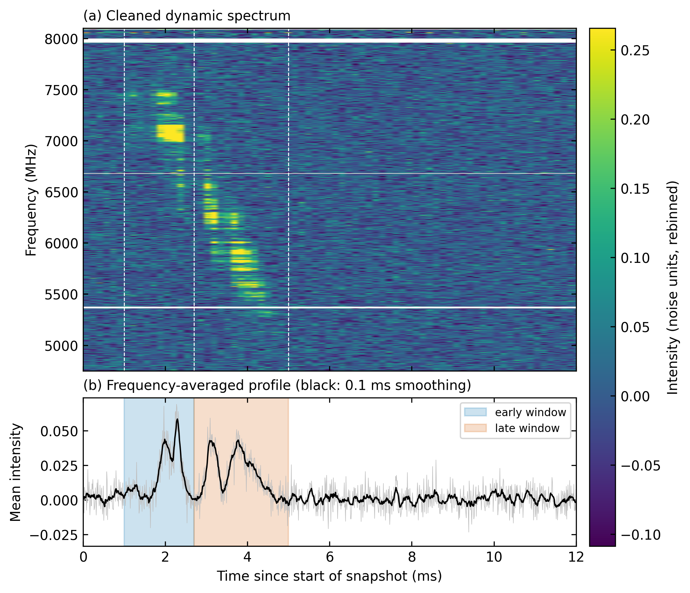
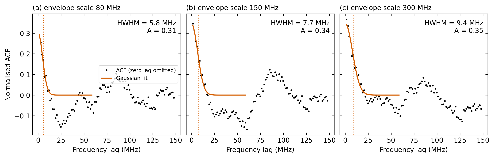
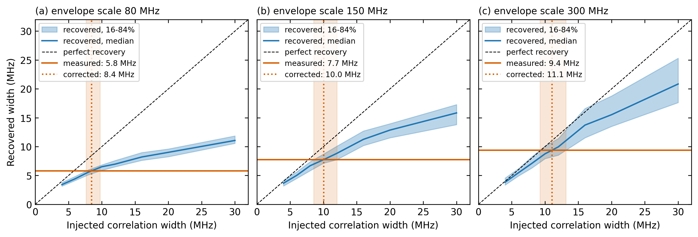

# Frequency Autocorrelation Analysis of FRB 121102: Investigating Spectral Structure and Scintillation Bandwidths

*An independent analysis of public Green Bank Telescope observations using autocorrelation, injection–recovery calibration and noise controls.*

---

## In Brief

- **What this is:** a Python pipeline that measures the frequency-correlation width of FRB 121102 burst spectra with an autocorrelation (ACF) method motivated by Spitler et al. (2018), applied to public Breakthrough Listen GBT data (4–8 GHz).
- **Main result:** the later emission of burst 11A (2.7–5.0 ms) gives a calibrated correlation width of **≈ 9.85 MHz near 6 GHz** (8.45–11.06 MHz across three envelope-subtraction scales).
- **Main methodological finding:** the raw width depends on the envelope-subtraction scale (5.8–9.4 MHz across 80–300 MHz; largest/smallest ratio 1.62). Injection–recovery calibration with synthetic scintillation of known width reduces this spread (largest/smallest ratio 1.31).
- **Controls:** 0 of 5 burst-free windows and 0 of 200 white-noise spectra satisfy the detection rule.
- **Main caveat:** only one of five bursts gives a stable width, from one epoch. The result is a correlation width consistent in order of magnitude with Galactic scintillation, not a confirmed scintillation bandwidth.

---

## Key Results at a Glance

<p align="center">
  
</p>

**Dynamic spectrum:** Frequency–time representation of burst 11A, showing the observed emission across the analysed frequency band.

<p align="center">
  
</p>

**Autocorrelation analysis:** Autocorrelation functions and fitted frequency-correlation widths used to characterise the burst's spectral structure.

<p align="center">
  
</p>

**Injection–recovery calibration:** Recovery of synthetic spectral structures with known input widths, used to assess and calibrate the measured characteristic bandwidth.

---

## Contents

- [Abstract](#abstract)
- [1. Scientific Motivation](#1-scientific-motivation)
- [2. Observational Data](#2-observational-data)
- [3. Analysis Methodology](#3-analysis-methodology)
- [4. Filtering Bias and Injection–Recovery Calibration](#4-filtering-bias-and-injectionrecovery-calibration)
- [5. Validation and Control Experiments](#5-validation-and-control-experiments)
- [6. Results: Burst 11A](#6-results-burst-11a)
- [7. Results Across the Five Bursts](#7-results-across-the-five-bursts)
- [8. Comparison with Published Work](#8-comparison-with-published-work)
- [9. Discussion and Physical Interpretation](#9-discussion-and-physical-interpretation)
- [10. Limitations and Future Work](#10-limitations-and-future-work)
- [11. Reproducing the Analysis](#11-reproducing-the-analysis)
- [12. Repository Structure](#12-repository-structure)
- [13. Principal Analysis Settings](#13-principal-analysis-settings)
- [14. References](#14-references)

---

## Abstract

Fast Radio Bursts (FRBs) are millisecond-duration radio transients whose observed signals carry information about both their emission mechanisms and the environments through which their radiation propagates. In particular, frequency-dependent variations in their observed spectra can arise from interference between radio waves travelling along different paths through inhomogeneous ionised plasma. Such variations provide a potential observational probe of propagation effects, including interstellar scintillation.

This project investigates the frequency-correlation structure of FRB 121102 using publicly available observations obtained with the Green Bank Telescope (GBT) through the Breakthrough Listen digital backend. The analysis implements a frequency autocorrelation method motivated by Spitler et al. (2018), with particular attention to the reliability of the characteristic frequency scale recovered from the data.

A modular Python pipeline was developed to read calibrated observational data, estimate channel-dependent noise, identify contaminated frequency channels, construct burst spectra, remove broad spectral envelopes, calculate frequency autocorrelation functions (ACFs), and estimate characteristic correlation widths through Gaussian fitting.

A central methodological difficulty is that the inferred correlation width depends on the treatment of broad spectral structure. To investigate this dependence, three envelope-subtraction scales of 80, 150 and 300 MHz were examined. Injection–recovery experiments were then performed by introducing artificial scintillation-like spectral patterns with known characteristic widths into real burst-free spectra. The resulting recovered-versus-injected relationship was used to calibrate the measurements.

The principal result is obtained from the later emission of burst 11A, between 2.7 and 5.0 ms. The calibrated characteristic frequency widths are 8.45, 10.04 and 11.06 MHz for the three envelope-smoothing configurations, respectively, giving a mean of approximately **9.85 MHz near 6 GHz**.

Additional tests involving burst-free windows, synthetic white-noise spectra, alternative noise normalisation and calibration-array ordering were performed to investigate the sensitivity of the measurement to particular processing choices.

Only one of the five examined bursts produces a characteristic width that remains sufficiently stable across all three smoothing configurations. The early emission of burst 11A also exhibits substantial dependence on the adopted filtering scale.

The measured characteristic scale is comparable in order of magnitude to some published measurements and expectations for Galactic scintillation. However, the analysis does not establish that the observed spectral correlations originate from scintillation. Intrinsic emission structure and other propagation effects remain possible explanations.

The primary contribution of this project is therefore twofold: an empirical measurement of burst-associated frequency correlations in public FRB 121102 observations, and an investigation of the methodological conditions under which such a measurement can be considered reliable.

---

## 1. Scientific Motivation

### 1.1 Fast Radio Bursts and propagation through plasma

Fast Radio Bursts are extremely energetic, short-duration radio transients originating at extragalactic distances. Their observed durations are typically of the order of milliseconds, although their underlying emission mechanisms and detailed source environments remain active areas of research.

FRB 121102 is particularly important because it was the first FRB identified as a repeating source. It is associated with a compact host galaxy at a redshift of approximately 0.193.

As radio emission travels from an FRB source towards Earth, it encounters ionised material in several environments:

- The immediate environment of the FRB source.
- The host galaxy.
- The intergalactic medium.
- The Milky Way interstellar medium.

Variations in the electron density of these intervening media can modify the propagation of radio waves.

In an inhomogeneous plasma, different portions of an incident wavefront can experience different propagation delays and arrive at the observer along different paths. The resulting waves interfere.

Depending on their relative phases, the interference can enhance or suppress the observed intensity at particular frequencies.

Consequently, the observed spectrum can exhibit alternating bright and faint regions even when the intrinsic emission spectrum is comparatively smooth.

This phenomenon provides a connection between the observed frequency structure of an FRB and the physical properties of the intervening plasma.

### 1.2 Scintillation and characteristic frequency scales

One manifestation of propagation-induced interference is scintillation.

In the strong-scattering regime, multiple propagation paths can produce a frequency-dependent interference pattern. The intensity variations are correlated over a characteristic frequency interval, commonly described by the scintillation bandwidth or decorrelation bandwidth.

At frequency separations smaller than this characteristic scale, the spectral intensities tend to retain a stronger correlation. At larger separations, the correlation generally decreases.

The characteristic bandwidth depends on the scattering properties of the intervening medium and is related to the distribution of propagation delays.

Consequently, measuring this frequency scale can potentially provide information about the plasma responsible for the scattering.

However, identifying a characteristic frequency scale is not sufficient to establish a scintillation origin.

Intrinsic spectral variations produced by the FRB emission mechanism can also introduce frequency-dependent correlations. Plasma lensing and other propagation effects may produce additional spectral structures.

A physical interpretation therefore requires distinguishing between the existence of a measurable frequency-correlation scale and the mechanism responsible for producing it.

This distinction is central to the present analysis.

### 1.3 Motivation from previous work

The principal methodological motivation for this project comes from Spitler et al. (2018).

They investigated bursts from FRB 121102 using the Effelsberg 100-m radio telescope at approximately 4.85 GHz and reported a characteristic scintillation bandwidth of approximately 6.4 ± 1.6 MHz.

Their analysis demonstrated how frequency autocorrelation can be used to investigate spectral structure associated with propagation effects.

Subsequent observations of FRB 121102 using the Green Bank Telescope extended the available frequency coverage to 4–8 GHz.

Gajjar et al. (2018) reported high-frequency detections using the Breakthrough Listen digital backend and investigated the frequency structure of the observed bursts.

Levkov et al. (2022) subsequently examined spectral features in the same GBT observations and reported substantially different decorrelation bandwidths.

These studies motivate an important methodological question:

**To what extent does the characteristic frequency width recovered from an FRB spectrum depend on the analysis procedure used to extract it?**

The original Effelsberg observations used by Spitler et al. are not publicly available for a direct independent reproduction of their measurement.

The objective here is therefore not to reproduce their numerical result. Instead, the underlying autocorrelation approach is implemented independently and applied to public GBT observations of the same repeating source.

The project places particular emphasis on investigating filtering bias, measurement calibration and the limitations of interpreting a frequency-correlation width as a scintillation bandwidth.

### 1.4 Research questions

The analysis addresses the following questions:

1. Can a characteristic frequency-correlation width be recovered from publicly available GBT observations of FRB 121102?
2. How does the inferred width depend on the removal of broad spectral structure?
3. Can injection–recovery experiments quantify and correct the bias introduced by the analysis pipeline?
4. Do burst-free observations and synthetic noise produce comparable autocorrelation features?
5. Is the resulting characteristic scale comparable to published measurements and theoretical expectations?
6. Does the measurement remain stable across different bursts and different temporal components of the same burst?

---

## 2. Observational Data

### 2.1 Data source

The analysis uses publicly released Breakthrough Listen observations of FRB 121102 obtained with the Green Bank Telescope.

**Data source:** [Breakthrough Listen – FRB 121102 Technical Data](https://seti.berkeley.edu/frb121102/technical.html)

The observations cover the nominal 4–8 GHz receiver band and are available in calibrated PSRFITS format.

The primary dataset is:

`11A_16sec.calib.4p`

This snapshot contains the bright burst 11A and provides the main observational dataset for the analysis.

Four additional burst snapshots were considered:

- `11B_263sec.calib.4p`
- `11C_284sec.calib.4p`
- `11E_344sec.calib.4p`
- `11K_769sec.calib.4p`

### 2.2 Instrumental and data characteristics

| Parameter | Description |
|---|---|
| Source | FRB 121102 |
| Telescope | Green Bank Telescope |
| Backend | Breakthrough Listen digital backend |
| Nominal observing band | 4–8 GHz |
| Analysed frequency range | Approximately 4750–8100 MHz |
| Data format | Calibrated PSRFITS |
| Analysed polarisation | Total intensity (Stokes I) |
| Original frequency resolution | Approximately 0.183 MHz |
| Time resolution | Approximately 10.24 μs |
| Original number of frequency channels | 19,456 |
| Frequency averaging | Eight neighbouring channels |
| Effective frequency resolution | Approximately 1.46 MHz |

The original observations provide considerably finer frequency resolution than required for the final ACF analysis.

Neighbouring frequency channels are therefore averaged in groups of eight to reduce noise fluctuations and computational complexity.

This results in an effective channel spacing of approximately 1.46 MHz.

The resulting frequency resolution is important when interpreting the fitted characteristic widths: a measured width of approximately 10 MHz is represented by several effective frequency channels rather than by a single channel.

### 2.3 Channel-dependent noise and radio-frequency interference

Different frequency channels can exhibit different noise properties.

Furthermore, persistent radio-frequency interference (RFI), instrumental features and contaminated band edges can introduce spectral variations unrelated to the astrophysical burst.

Before calculating the autocorrelation, the pipeline estimates the off-pulse mean and standard deviation independently for each frequency channel.

Channels with anomalous noise properties are identified and masked. The mask is expanded around flagged channels to reduce contamination from neighbouring channels.

The adopted analysis also excludes frequencies outside approximately 4750–8100 MHz.

Persistent interference features are particularly noticeable near approximately 5.4, 6.7 and 8.0 GHz.

The masking procedure is important because a small number of anomalous channels can introduce artificial frequency correlations.

### 2.4 Temporal structure of burst 11A

Burst 11A exhibits several bright, frequency-localised emission regions.

The emission appears to drift from higher to lower frequencies over a few milliseconds. This drift is noted qualitatively and has not been quantified in the present analysis.

The emission does not occupy the entire observing band uniformly at a given time.

This produces broad spectral structure when the signal is averaged over a selected time interval.

Such broad structure is important because it can influence the autocorrelation function and potentially bias the inferred characteristic frequency width.

The primary analysis therefore focuses on a carefully selected temporal component rather than averaging the entire burst indiscriminately.

---

## 3. Analysis Methodology

The analysis is implemented as a modular Python pipeline.

The individual stages are separated into data reading, normalisation, channel masking, spectral construction, envelope subtraction, autocorrelation, Gaussian fitting and injection–recovery calibration.

The following sections describe the reasoning behind each stage.

### 3.1 Reading and normalising the observational data

The calibrated PSRFITS file is read using Astropy.

The data are converted into a representation suitable for frequency-domain analysis, with total intensity retained for the subsequent processing.

For each frequency channel, the pipeline estimates:

- The mean intensity in the off-pulse region.
- The standard deviation of the off-pulse intensity.

The mean is subtracted from the corresponding channel, and its fluctuations are expressed relative to its independently estimated noise level.

This produces a dimensionless, noise-normalised intensity spectrum.

The motivation for performing this operation independently for each channel is that the instrumental noise need not be uniform across the observing band.

Without this correction, variations in the receiver response or channel-dependent noise could contribute to the measured spectral structure.

An alternative normalisation using a smoothed estimate of the noise level is also implemented later as a consistency check.

### 3.2 Frequency-channel masking

Channels with anomalous noise properties are identified using a robust estimate of the distribution of channel noise.

The median and median absolute deviation are used to identify channels that deviate substantially from the typical noise level.

The mask is expanded by approximately ten neighbouring channels on either side to reduce contamination from nearby affected frequencies.

Band edges outside the adopted analysis range are also excluded.

This produces a frequency spectrum in which unreliable channels are represented by missing values rather than being allowed to contribute to the autocorrelation.

The ACF implementation accounts for these missing channels when calculating correlations.

### 3.3 Constructing the burst spectrum

For a selected time interval, the noise-normalised intensity is averaged over the corresponding time bins.

This produces a one-dimensional spectrum as a function of frequency.

The frequency spectrum is then averaged over groups of eight neighbouring channels.

Averaging reduces random fluctuations and improves the stability of the subsequent correlation analysis.

However, averaging also limits the smallest frequency scale that can be resolved reliably.

The analysis therefore uses a consistent effective frequency resolution throughout the measurement and calibration procedures.

### 3.4 Why broad spectral structure must be removed

The observed spectrum contains variations on multiple frequency scales.

Some variations may correspond to relatively broad changes in the burst emission envelope, while others may represent narrower frequency-dependent modulation.

The objective of this analysis is to investigate the latter.

A direct autocorrelation of the complete spectrum would mix these different contributions.

For example, a broad region of enhanced emission can cause frequencies separated by several tens or hundreds of MHz to exhibit correlations that are unrelated to the narrow spectral structure of interest.

To reduce this contribution, the analysis constructs a smoothed representation of the spectrum.

This smoothed spectrum acts as an estimate of the broad spectral envelope.

Subtracting it from the original spectrum produces a residual spectrum containing the finer frequency-dependent variations.

The choice of smoothing scale is critical.

- If the smoothing scale is too narrow, genuine spectral structure can be absorbed into the estimated envelope and removed.
- If the smoothing scale is too broad, substantial contributions from the broad spectral envelope can remain in the residual spectrum.

Neither situation is desirable.

Rather than assuming that one particular smoothing scale is optimal, the analysis investigates three configurations.

| Smoothing scale | Purpose |
|---|---|
| 80 MHz | Removes relatively narrow broad-band variations |
| 150 MHz | Provides an intermediate envelope estimate |
| 300 MHz | Removes broader spectral variations |

The dependence of the recovered width on these three choices provides an empirical assessment of the sensitivity of the measurement to envelope subtraction.

### 3.5 Frequency autocorrelation function

After subtracting the broad spectral envelope, the residual spectrum is used to calculate its frequency autocorrelation function.

Conceptually, the ACF measures how similar the residual spectrum is to a frequency-shifted version of itself.

At zero frequency separation, the spectrum is perfectly correlated with itself.

As the separation increases, the correlation generally decreases.

A narrow central feature in the ACF therefore indicates that spectral fluctuations retain a measurable degree of correlation over a characteristic frequency interval.

The implementation accounts for masked channels by considering only frequency pairs for which valid data are available.

The resulting autocorrelation is normalised so that its zero-lag value is unity.

This allows the relative shape and width of the correlation feature to be examined independently of the overall amplitude of the residual spectrum.

### 3.6 Gaussian fitting and characteristic width

The central positive-lag region of the ACF is fitted with a Gaussian profile.

The zero-lag point is excluded from the fit.

This is important because the zero-lag autocorrelation contains the contribution of every valid spectral sample correlating with itself, including its own noise contribution.

Retaining this point could disproportionately influence the fitted central feature.

The fitting procedure considers frequency lags up to 60 MHz.

The reported characteristic width is the **half-width at half-maximum (HWHM)** of the fitted Gaussian.

The HWHM represents the frequency separation at which the fitted central correlation feature falls to half its fitted peak amplitude.

It is important to distinguish this operationally defined width from a universally defined scintillation bandwidth.

Different studies may use different fitting functions, baseline treatments, normalisations or definitions of decorrelation bandwidth.

The present analysis consistently reports the fitted Gaussian HWHM so that the measurements and calibration procedure use the same definition.

The formal uncertainty returned by the Gaussian fit is also not treated as the complete measurement uncertainty. It describes the local fit under the adopted model, not the systematic uncertainty introduced by preprocessing and filtering.

### 3.7 Exploratory detection criterion

To investigate whether a fitted feature persists across the different envelope-smoothing configurations, the pipeline uses two conditions:

- The fitted Gaussian amplitude must be at least 0.1.
- The fitted HWHM must be at least 3 MHz.

Both conditions must be satisfied at all three smoothing scales.

These conditions were selected after examining burst 11A and subsequently held fixed for the other analyses.

They are therefore exploratory consistency criteria rather than independently calibrated statistical detection thresholds.

Passing the criterion indicates that the fitted central correlation feature persists across the tested processing configurations.

It does not establish a formal detection significance or prove that the feature is astrophysical.

---

## 4. Filtering Bias and Injection–Recovery Calibration

### 4.1 Why the raw measurement can be biased

Removing the broad spectral envelope is necessary for isolating finer spectral structure, but the filtering operation can also modify the structure being measured.

In particular, a smoothed envelope may partially absorb genuine frequency correlations.

The degree of this suppression depends on the smoothing scale and on the spectral pattern itself.

This introduces a systematic dependence between the processing procedure and the characteristic width recovered from the ACF.

For burst 11A, the uncorrected widths are approximately:

| Envelope scale | Raw HWHM |
|---|---:|
| 80 MHz | 5.8 MHz |
| 150 MHz | 7.7 MHz |
| 300 MHz | 9.4 MHz |

The variation is substantial.

The largest raw width is approximately 60% greater than the smallest.

This demonstrates that the inferred characteristic width cannot simply be treated as independent of the envelope-subtraction procedure.

A calibration procedure is therefore required to investigate how the pipeline transforms spectral structures of known characteristic width.

### 4.2 Principle of injection–recovery

Injection–recovery experiments provide a way of testing a measurement procedure using synthetic signals whose underlying properties are known.

The basic idea is to construct a synthetic spectral pattern with a specified characteristic correlation width, introduce it into a representative observational background, and then process the resulting spectrum using the same pipeline applied to the real burst.

The recovered width can then be compared with the injected width.

If the pipeline consistently returns widths smaller than those introduced, the recovered-versus-injected relationship quantifies the systematic bias.

The calibration can then be used to estimate the underlying width corresponding to a measured value.

### 4.3 Construction of injected spectral patterns

The pipeline generates artificial scintillation-like patterns using a complex Gaussian random field.

The field is smoothed over a frequency-dependent scale and converted into an intensity pattern by taking its squared magnitude.

The resulting patterns have intensity statistics characteristic of fully modulated scintillation.

Each pattern is normalised to have unit mean before being applied to the broad spectral shape of the burst.

The artificial frequency structure is then combined with real burst-free spectra from the corresponding observational file.

This is important because the injection experiments retain several properties of the actual observations:

- The broad spectral shape of the burst.
- The channel mask.
- The frequency resolution.
- The background fluctuations.
- The noise characteristics of the observational data.

The injected patterns remain idealised representations of scintillation-like structure; they are not intended to reproduce every possible property of the actual FRB emission.

### 4.4 Injected characteristic widths

The pipeline investigates the following injected widths:

| Injected width (MHz) |
|---:|
| 4 |
| 6 |
| 8 |
| 10 |
| 12 |
| 16 |
| 20 |
| 30 |

For each injected width, multiple independent realisations are generated.

The standard configuration uses eight injection trials per width and per available burst-free background window.

The same analysis steps are applied to each injected spectrum:

1. Construct the synthetic frequency modulation.
2. Combine it with the burst-shaped spectral envelope.
3. Add the real burst-free background.
4. Apply the channel mask.
5. Subtract the broad spectral envelope.
6. Calculate the frequency ACF.
7. Fit the Gaussian central correlation feature.
8. Apply the detection criterion.

The recovered widths are collected separately for each envelope-smoothing configuration.

### 4.5 Recovery distributions and calibration

For each injected width and smoothing scale, the pipeline calculates the 16th, 50th and 84th percentiles of the recovered widths.

The median recovery curve provides the principal calibration relation.

The 16th and 84th percentile curves describe the spread in recovered widths under the simulated configurations.

The measured width from the real burst is then compared with these recovery curves.

The pipeline interpolates between injected widths to determine which injected characteristic width would produce the observed recovered width.

This produces a calibrated estimate and an associated calibration range.

An important feature of this approach is that the correction is performed separately for each envelope-smoothing scale.

Consequently, the calibration attempts to account for the different biases introduced by the different filtering configurations.

### 4.6 Injection–recovery results

The following table shows the fraction of injection trials that satisfy the detection rule at all three smoothing scales.

| Injected width (MHz) | Detection fraction |
|---:|---:|
| 4 | 0.750 |
| 6 | 1.000 |
| 8 | 1.000 |
| 10 | 1.000 |
| 12 | 1.000 |
| 16 | 1.000 |
| 20 | 1.000 |
| 30 | 0.925 |

The results indicate that the adopted measurement criterion successfully identifies most of the injected structures over the tested range.

The detection fraction is lower at 4 MHz, suggesting that the narrowest injected structures are more difficult to recover reliably.

The decrease at 30 MHz also indicates that the detection rule is not equally effective across the entire injected range.

The recovered widths are generally smaller than the injected widths, demonstrating the systematic suppression introduced by the processing procedure.

Within the tested injection configurations, the method appears most reliable for characteristic widths of approximately 6–20 MHz.

This range includes the widths obtained from the main burst 11A analysis.

However, this conclusion is conditional on the properties of the adopted injection model.

### 4.7 Corrected characteristic width

After injection–recovery correction, the three envelope configurations give:

| Envelope scale | Raw HWHM | Corrected width | Calibration range |
|---|---:|---:|---:|
| 80 MHz | 5.8 MHz | 8.45 MHz | 7.66–9.74 MHz |
| 150 MHz | 7.7 MHz | 10.04 MHz | 8.56–12.03 MHz |
| 300 MHz | 9.4 MHz | 11.06 MHz | 9.25–13.16 MHz |

The mean calibrated characteristic width is:

**9.85 MHz**

The range across the three smoothing configurations is:

**8.45–11.06 MHz**

The calibration reduces the spread between the three estimates compared with the uncorrected measurements: the ratio of the largest to the smallest width falls from about 1.62 (raw) to about 1.31 (corrected).

This suggests that the injection–recovery procedure successfully compensates for part of the filtering dependence.

Nevertheless, the three measurements are obtained from the same burst spectrum. They are not independent measurements.

The range across smoothing configurations is therefore a measure of methodological robustness, not a formal statistical confidence interval.

Similarly, the individual calibration ranges describe the spread associated with the simulated recovery procedure. They do not constitute a complete uncertainty budget for the astrophysical measurement.

The correction also remains model-dependent because the injected spectral patterns may not reproduce every property of the actual burst.

The calibrated value should therefore be interpreted as an estimate within the assumptions of the injection model, rather than as a definitive measurement of the intrinsic spectral or scintillation bandwidth.

---

## 5. Validation and Control Experiments

A fitted ACF feature is not automatically evidence for astrophysical frequency structure.

Noise, residual instrumental effects and processing choices can all produce apparent correlations.

Several additional experiments were therefore performed to investigate the internal consistency of the measurement.

### 5.1 Burst-free windows

The analysis was applied to five burst-free windows within the selected off-pulse interval.

These windows have the same duration as the primary burst-analysis window.

The objective is to investigate whether the adopted fitting procedure can identify comparable correlation features when no burst emission is present.

**Result:**

- Burst-free windows examined: 5.
- Windows satisfying the detection rule: 0.

None of the examined windows produced a fitted feature satisfying the adopted criteria at all three envelope-smoothing scales.

Some windows exhibited narrow autocorrelation spikes with widths below approximately one effective frequency channel, consistent with noise-related correlations.

This test provides evidence that the main burst feature is not readily reproduced in the particular burst-free intervals examined.

However, five windows are insufficient to establish a comprehensive statistical false-alarm probability.

### 5.2 Synthetic white-noise simulations

A separate experiment was performed using synthetic white-noise spectra.

The objective is to determine whether random fluctuations alone can satisfy the same detection criterion.

A total of 200 independent noise spectra were generated and processed using the same ACF fitting procedure.

**Result:**

| Quantity | Result |
|---|---:|
| Noise spectra generated | 200 |
| Spectra passing the detection rule | 0 |
| Detection fraction | 0 |

None of the simulated white-noise spectra satisfied the adopted criterion across all three smoothing scales.

This demonstrates that the particular detection rule rejects the tested random-noise realisations.

It does not establish a formal false-alarm probability for the complete analysis.

In particular, the thresholds were selected after examining burst 11A, and the simulations do not capture every possible form of correlated instrumental noise or residual spectral structure.

### 5.3 Alternative noise normalisation

The primary analysis estimates the noise independently for each frequency channel using the off-pulse region.

To investigate whether the measurement depends strongly on this choice, the pipeline was repeated using a smoothed estimate of the channel noise level.

The resulting raw widths are:

| Envelope scale | Adopted normalisation | Alternative normalisation |
|---|---:|---:|
| 80 MHz | 5.80 MHz | 5.78 MHz |
| 150 MHz | 7.70 MHz | 7.74 MHz |
| 300 MHz | 9.40 MHz | 9.38 MHz |

The two normalisation procedures produce nearly identical widths.

This suggests that the observed dependence on the envelope-smoothing scale is not primarily introduced by the particular choice between these two noise-normalisation procedures.

It does not exclude other possible systematic effects.

### 5.4 Calibration-array ordering

The PSRFITS reader also includes a consistency check of the ordering of the calibration scale factors.

An alternative, deliberately incorrect ordering was tested to examine its effect on the resulting quiet-sky bandpass.

The adopted ordering produces a bandpass roughness measure of 0.0587, compared with 0.4778 for the alternative ordering.

The substantially smoother bandpass obtained using the adopted ordering supports the consistency of the implemented data-reading procedure.

This is an instrumental data-handling check, not an independent astrophysical validation of the measured frequency correlations.

### 5.5 Interpretation of the validation tests

Together, the injection–recovery experiments, burst-free window tests, white-noise simulations, alternative normalisation and calibration-array ordering check investigate different possible sources of measurement bias.

They provide evidence that the candidate feature is reasonably stable under the particular processing choices examined.

However, the tests should not be interpreted as proving the absence of all systematic effects.

In particular:

- The white-noise simulations do not reproduce every possible form of instrumental interference.
- The number of burst-free windows is limited.
- The injection model is idealised.
- The detection thresholds were selected after inspecting the principal burst.
- The tests do not distinguish intrinsic emission structure from propagation-induced modulation.

The validation therefore concerns the internal behaviour of the measurement procedure rather than the definitive physical origin of the observed structure.

---

## 6. Results: Burst 11A

### 6.1 Primary analysis window

The principal measurement is obtained from the later emission of burst 11A.

The selected time interval is 2.7–5.0 ms, measured from the beginning of the observational snapshot.

The analysis is centred near 6 GHz.

The approximate signal-to-noise ratio calculated using the adopted profile-based estimator is 34.3.

A total of 1817 frequency channels are masked during the processing.

The selected window provides the most stable characteristic width among the analysed burst components.

### 6.2 Calibrated frequency-correlation widths

The principal results are summarised below.

| Parameter | Result |
|---|---|
| Burst | 11A |
| Time interval | 2.7–5.0 ms |
| Approximate centre frequency | 6000 MHz |
| Approximate S/N | 34.3 |
| Masked channels | 1817 |
| Effective frequency resolution | Approximately 1.46 MHz |
| Mean calibrated width | 9.85 MHz |

The calibrated widths obtained using the three envelope-smoothing configurations are:

| Envelope scale | Raw HWHM (MHz) | Fit amplitude | Calibrated HWHM | Calibration range |
|---|---:|---:|---:|---:|
| 80 MHz | 5.8 | 0.31 | 8.45 MHz | 7.66–9.74 MHz |
| 150 MHz | 7.7 | 0.34 | 10.04 MHz | 8.56–12.03 MHz |
| 300 MHz | 9.4 | 0.35 | 11.06 MHz | 9.25–13.16 MHz |

The mean calibrated characteristic width is approximately 9.85 MHz.

The three individual measurements are reasonably consistent compared with the original uncorrected widths.

### 6.3 Dependence on spectral-envelope subtraction

The raw widths increase systematically as the envelope-smoothing scale increases.

This indicates that the broad spectral component contributes to the measured correlation structure in a way that depends on the adopted filtering procedure.

After injection–recovery correction, the three widths become more closely grouped.

The calibration therefore reduces the sensitivity of the measurement to the envelope-subtraction scale.

However, the remaining spread is important.

The three estimates do not represent three independent observations of the same physical quantity. They are three analyses of the same observational spectrum under different processing assumptions.

Their agreement is evidence of relative stability under those assumptions, not independent confirmation of the measured width.

### 6.4 Dynamic spectrum

The dynamic spectrum provides the time-frequency representation of burst 11A.

It reveals the distribution of emission across the observing band and the temporal evolution of the frequency-localised structures.

The emission appears in several bright regions that evolve over a few milliseconds.

This structure motivates the separate treatment of the early and late portions of the burst.

**Figure: Dynamic spectrum of burst 11A**

Generated as:

`figures/11A_dynamic_spectrum.png`

### 6.5 Frequency autocorrelation functions

The ACFs obtained using the three envelope-smoothing configurations exhibit a central correlation feature that can be fitted with a Gaussian.

The zero-lag point is excluded from the fitting procedure.

The negative dip following the central correlation peak is also visible.

This feature is expected to be influenced partly by the subtraction of the smoothed spectral envelope.

A broader feature around approximately 85–100 MHz is visible, particularly in the 150 and 300 MHz smoothing configurations.

Its physical origin has not been established.

**Figure: Frequency ACFs and Gaussian fits**

Generated as:

`figures/11A_acf_fits.png`

### 6.6 Injection–recovery calibration figure

The injection–recovery figure shows the relationship between the known injected widths and the widths recovered by the analysis pipeline.

The departure from an ideal one-to-one relationship demonstrates the systematic bias introduced by the processing procedure.

The calibration curves are used to infer the corrected widths reported above.

**Figure: Injection–recovery calibration**

Generated as:

`figures/11A_injection_recovery.png`

### 6.7 Early and late emission

The early portion of burst 11A, between 1.0 and 2.7 ms, was analysed independently.

The uncorrected characteristic widths are:

| Envelope scale | Early-window HWHM |
|---|---:|
| 80 MHz | 3.8 MHz |
| 150 MHz | 13.6 MHz |
| 300 MHz | 31.2 MHz |

The substantial variation demonstrates that the estimator does not recover a stable characteristic width for this component under the adopted processing procedure.

The measurement is therefore restricted to the later emission.

This comparison also highlights the importance of temporal window selection when investigating the frequency structure of short-duration radio bursts.

A spectrum averaged over different emission components need not exhibit the same correlation properties.

### 6.8 Additional broad correlation feature

An additional ACF feature is visible at frequency lags of approximately 85–110 MHz in both the early and late portions of burst 11A.

The feature is not apparent in the tested burst-free windows and persists across the examined smoothing configurations.

Its physical origin remains unclear.

Levkov et al. (2022) report spectral peaks separated by approximately 95 ± 16 MHz in the same GBT observations.

The similarity in frequency scale is interesting, but the present analysis does not establish a physical connection between these features.

It is therefore treated as an additional observational feature rather than assigned a specific propagation or emission mechanism.

---

## 7. Results Across the Five Bursts

The analysis was not restricted to burst 11A.

Four additional burst snapshots were examined to investigate whether comparable frequency-correlation widths could be recovered from other emission events.

| Burst | Approximate S/N | Outcome |
|---|---:|---|
| 11A | 34.3 | Passes the detection criterion at all three envelope scales |
| 11E | 17 | Candidate structure, but no stable width |
| 11K | 11 | No usable characteristic width |
| 11C | Approximately 7 | Screened out because of low S/N |
| 11B | Approximately 5 | Screened out because of low S/N |

Only burst 11A provides a sufficiently stable characteristic width under the adopted procedure.

Burst 11E exhibits candidate structure, but its fitted amplitude falls below the adopted threshold at one smoothing scale.

The remaining bursts either fail the detection criterion or are screened out before the full measurement.

The S/N estimates should be interpreted as approximate.

For some bursts, analysis windows were selected through visual inspection, whereas others used automatically suggested windows. The values are consequently not strictly comparable.

The small number of usable bursts also prevents a meaningful investigation of the relationship between signal-to-noise ratio and measurement reliability.

The results therefore establish a candidate measurement in one burst component, rather than a general characteristic bandwidth for FRB 121102.

---

## 8. Comparison with Published Work

The measured characteristic frequency width is compared with previous studies of FRB 121102.

These comparisons provide physical context for the result but must be interpreted carefully because the studies differ in observational setup, processing procedure and measurement definition.

### 8.1 Spitler et al. (2018)

Spitler et al. (2018) investigated FRB 121102 using the Effelsberg 100-m radio telescope at approximately 4.85 GHz.

Their analysis reported a characteristic scintillation bandwidth of approximately:

**6.4 ± 1.6 MHz at 4.85 GHz.**

For an approximate comparison with the present result near 6 GHz, an assumed frequency dependence of the scintillation bandwidth can be applied.

For Galactic diffractive scintillation, the characteristic bandwidth is commonly expected to increase steeply with observing frequency.

Using frequency-scaling indices between 4 and 4.4 gives an extrapolated value of approximately:

**15–16 MHz near 6 GHz.**

The mean calibrated width obtained here, approximately 9.85 MHz, is lower than this extrapolated value but remains of the same general order of magnitude.

Several factors could contribute to the difference:

- The observations were obtained using different telescopes.
- The measurements correspond to different observing epochs.
- The propagation conditions may have changed.
- The analysis procedures and width definitions may differ.
- The frequency dependence used for the extrapolation is assumed rather than measured in this project.

The comparison is therefore contextual rather than a direct reproduction of the published measurement.

### 8.2 Gajjar et al. (2018)

Gajjar et al. (2018) reported high-frequency observations of FRB 121102 using the Breakthrough Listen digital backend at the Green Bank Telescope.

Their analysis investigated frequency-dependent spectral structure in the same observational dataset considered here.

For burst 11A, their ACF analysis reports a characteristic width of:

**11.5 ± 1.2 MHz**

in a sub-band centred at approximately 6.407 GHz.

The mean calibrated width obtained in the present analysis can be scaled from approximately 6.0 GHz to 6.4 GHz using the same assumed frequency-scaling range.

This gives approximately:

**12.8–13.1 MHz near 6.4 GHz.**

This is reasonably close to the value reported by Gajjar et al.

However, the comparison requires an important qualification: both analyses use the same underlying GBT observation.

The agreement is therefore a comparison between different analyses of the same observational data, rather than independent observational confirmation.

Differences in the selected frequency intervals, preprocessing, envelope subtraction, fitting procedure and measurement definitions may contribute to the remaining discrepancy.

Gajjar et al. also discuss fine-scale spectral structures of approximately 10–50 MHz across bursts, which they associate with Galactic diffractive scintillation.

### 8.3 Levkov et al. (2022)

Levkov et al. (2022) re-examined the spectral properties of FRB 121102 using the same GBT observations.

They reported a decorrelation bandwidth of approximately:

**3.3 ± 0.6 MHz at 6 GHz.**

This is substantially smaller than the mean calibrated width of approximately 9.85 MHz obtained here.

The difference is particularly important because it demonstrates that different analysis procedures can produce significantly different characteristic widths from the same observational data.

The values should not be treated as directly interchangeable without matching their definitions of the correlation width and the details of their respective processing procedures.

Levkov et al. also report spectral peaks separated by approximately 95 ± 16 MHz in the same GBT observations.

This is potentially relevant to the broader ACF feature around 85–110 MHz observed in the present analysis.

However, a direct connection between these features has not been investigated.

### 8.4 Summary of the literature comparison

| Study | Observational data | Reported characteristic width |
|---|---|---:|
| Spitler et al. (2018) | Effelsberg, 4.85 GHz | 6.4 ± 1.6 MHz |
| Gajjar et al. (2018) | GBT, 6.407 GHz | 11.5 ± 1.2 MHz |
| Levkov et al. (2022) | GBT, approximately 6 GHz | 3.3 ± 0.6 MHz |
| Present analysis | GBT, approximately 6 GHz | 9.85 MHz mean calibrated width |

The comparison illustrates an important methodological point.

A characteristic frequency scale extracted from an FRB spectrum is not necessarily independent of the analysis procedure used to define and measure it.

In particular, the difference between the present result and the Levkov et al. measurement motivates further investigation of the effects of spectral-envelope subtraction, fitting conventions and the physical interpretation of the observed correlations.

The frequency scaling used in the comparisons is assumed and has not been independently measured using the present dataset.

---

## 9. Discussion and Physical Interpretation

The analysis identifies a characteristic frequency-correlation width in the later emission of burst 11A.

Following injection–recovery calibration, the mean width is approximately 9.85 MHz near 6 GHz.

The result is reasonably stable across the three envelope-smoothing configurations, although the raw measurement exhibits a substantial dependence on the adopted filtering scale.

The injection–recovery experiments demonstrate that this dependence can be reduced by calibrating the pipeline against artificial spectral patterns of known characteristic width.

The burst-free and synthetic-noise tests also suggest that the adopted detection criterion is not readily satisfied by the particular noise realisations examined.

Nevertheless, several distinctions are essential when interpreting the result.

### 9.1 A measured correlation scale is not necessarily a scintillation bandwidth

The ACF identifies correlations in the observed spectrum.

It does not independently identify the physical process responsible for producing them.

Intrinsic emission structure could introduce frequency-dependent variations with a characteristic correlation scale.

Propagation effects such as plasma lensing could also contribute.

The present analysis does not distinguish these possibilities.

Consequently, the approximately 9.85 MHz result is most appropriately described as a calibrated characteristic frequency-correlation width.

Its interpretation as a scintillation bandwidth remains conditional.

### 9.2 The importance of calibration

The difference between the raw and calibrated widths demonstrates why processing bias cannot be ignored.

The raw measurement changes substantially with the envelope-smoothing scale.

The injection–recovery procedure reduces this dependence by empirically estimating how the pipeline transforms known input widths.

However, the calibration is only as representative as its injected spectral patterns.

A more realistic injection model, incorporating a wider range of spectral modulation properties, could improve the robustness of the correction.

### 9.3 The discrepancy between published measurements

The comparison with Gajjar et al. and Levkov et al. is particularly instructive.

The present result is reasonably close to the characteristic width reported by Gajjar et al., especially after applying the assumed frequency scaling.

However, Levkov et al. report a substantially smaller decorrelation bandwidth using the same underlying GBT observations.

This difference demonstrates that the measurement definition and preprocessing choices are central to interpreting characteristic spectral widths.

It also motivates a more systematic comparison in which the same frequency intervals, masking procedures, normalisation conventions and fitting prescriptions are applied to the same data.

### 9.4 Limited observational sample

Only one of the five examined bursts provides a sufficiently stable measurement.

The result cannot therefore establish whether the measured width is representative of FRB 121102 generally.

The early emission of burst 11A also fails to provide a stable width.

This suggests that the reliability of the estimator depends on the structure and signal quality of the selected burst component.

A larger sample would be necessary to investigate these dependencies systematically.

---

## 10. Limitations and Future Work

### 10.1 Limited number of robust measurements

Only the later emission of burst 11A produces a stable characteristic width across the three envelope-smoothing configurations.

The remaining bursts either fail the adopted criterion or are screened out because of insufficient signal-to-noise ratios.

The present sample is too small to establish a general relationship between signal-to-noise ratio and measurement reliability.

### 10.2 Dependence on filtering choices

The raw ACF widths vary with the spectral-envelope smoothing scale.

Although injection–recovery calibration reduces this dependence, the inferred characteristic width remains conditional on the adopted filtering procedure.

Alternative envelope models and baseline treatments could produce different results.

### 10.3 Exploratory detection thresholds

The amplitude and HWHM thresholds were selected after inspecting burst 11A.

Although they were held fixed for subsequent analyses, they were not independently calibrated using a separate training sample.

The resulting detection rule is therefore an exploratory consistency criterion rather than a statistically established significance threshold.

### 10.4 Injection-model assumptions

The injected patterns represent idealised scintillation-like spectral modulation.

Real FRB spectra may contain more complicated combinations of intrinsic emission structure and propagation effects.

A mismatch between the injected patterns and the actual spectral modulation could influence the calibration.

The corrected width should therefore be interpreted within the assumptions of the injection model.

### 10.5 Intrinsic spectral structure

The present analysis cannot independently separate intrinsic emission structure from propagation-induced spectral modulation.

Both can produce frequency-dependent correlations.

Additional observations across different frequencies and epochs would be necessary to investigate the origin of the measured structure.

### 10.6 Broad ACF feature

The additional feature around 85–110 MHz is observed in both the early and late portions of burst 11A.

Its origin is currently unexplained.

The similarity to the approximately 95 ± 16 MHz spectral-peak separation reported by Levkov et al. (2022) motivates further investigation, but no physical connection has been established.

### 10.7 Frequency dependence

The comparisons with published measurements at other observing frequencies use an assumed frequency-scaling index.

The present dataset does not independently establish the frequency dependence of the characteristic bandwidth.

Furthermore, the measured value should be understood as an effective characteristic scale for the analysed emission rather than a detailed measurement of how the bandwidth changes across the entire observing band.

### 10.8 Incomplete uncertainty budget

The injection–recovery calibration ranges describe the spread in the simulated recovery procedure.

They do not capture every possible uncertainty associated with the astrophysical measurement.

A complete uncertainty analysis would need to consider additional sources of systematic uncertainty, including the injection model, temporal window selection, residual instrumental structure and intrinsic spectral variations.

### 10.9 Possible future investigations

Several extensions could improve the analysis.

**1. Larger burst sample**

Applying the pipeline to a larger sample of sufficiently bright bursts would help determine whether the measured frequency-correlation scale is consistent across different emission events.

**2. Alternative ACF fitting procedures**

Investigating different fitting ranges, baseline treatments and functional forms would help establish how strongly the recovered width depends on the Gaussian fitting prescription.

**3. More realistic injection models**

Testing alternative spectral modulation models could reveal how sensitive the injection–recovery correction is to assumptions about the underlying frequency structure.

**4. Investigation of broad spectral features**

The additional ACF feature around 85–110 MHz deserves further examination, particularly in relation to the spectral-peak separations discussed by Levkov et al.

**5. Independent observations**

Applying the same measurement framework to observations obtained at different frequencies and epochs could help investigate whether the observed frequency structure evolves in a manner consistent with propagation through a turbulent plasma.

**6. Sub-band frequency scaling and multi-epoch tracking**

Measuring the width in sub-bands of the 4–8 GHz band, with the calibration repeated for each sub-band, would test directly whether the width follows the steep frequency scaling expected for scattering, instead of assuming it. Applying the same config-driven pipeline per burst, band and epoch would then allow the time variation of the width to be tracked. A fixed envelope filter could bias widths differently at different frequencies, so the injection–recovery calibration must be repeated for each band for such a scaling fit to be reliable.

Ultimately, the most useful extension would be to combine repeated frequency-correlation measurements with independent propagation diagnostics.

This would provide a more direct route towards distinguishing intrinsic emission structure from propagation-induced modulation.

---

## 11. Reproducing the Analysis

This repository is intended to make the analysis reproducible on an independent computer.

The original observational data are not included because of their size. Users must download the relevant calibrated PSRFITS files independently.

The following instructions reproduce the principal burst 11A analysis.

### 11.1 Software requirements

The pipeline uses:

| Package | Purpose |
|---|---|
| Python 3 | Main programming environment |
| NumPy | Numerical operations and array manipulation |
| SciPy | Filtering, autocorrelation and Gaussian fitting |
| Matplotlib | Data visualisation and figure generation |
| Astropy | Reading calibrated PSRFITS observations |
| pytest | Automated testing |

The package dependencies are specified in `requirements.txt` and `requirements-dev.txt`.

Python 3.10 or later is recommended for a straightforward setup.

### 11.2 Step 1: Install Python

Install Python from:

https://www.python.org/downloads/

Alternatively, use an existing Python distribution such as Anaconda or Miniconda.

Verify that Python is available from the terminal:

```bash
python --version
```

On some Linux and macOS systems, use:

```bash
python3 --version
```

### 11.3 Step 2: Clone the repository

Open a terminal or command prompt.

Navigate to the directory where you want to store the project.

Clone the repository:

```bash
git clone https://github.com/Vicks-03/FRB121102-acf3.git
```

Enter the repository directory:

```bash
cd FRB121102-acf3
```

### 11.4 Step 3: Create a virtual environment

Using a virtual environment keeps the dependencies of this project separate from other Python installations.

On Windows:

```bash
python -m venv .venv
```

Activate it using PowerShell:

```powershell
.venv\Scripts\Activate.ps1
```

On macOS or Linux:

```bash
python3 -m venv .venv
```

Activate it using:

```bash
source .venv/bin/activate
```

Once activated, the terminal should indicate that the virtual environment is active.

### 11.5 Step 4: Install the dependencies

Upgrade pip:

```bash
python -m pip install --upgrade pip
```

Install the required packages:

```bash
python -m pip install -r requirements.txt
```

This installs NumPy, SciPy, Matplotlib and Astropy.

To install the additional testing dependency:

```bash
python -m pip install -r requirements-dev.txt
```

The latter also installs pytest.

Verify that the packages have been installed:

```bash
python -c "import numpy, scipy, matplotlib, astropy; print('All main dependencies installed successfully.')"
```

### 11.6 Step 5: Download the observational data

Visit the official Breakthrough Listen FRB 121102 technical data page:

https://seti.berkeley.edu/frb121102/technical.html

Download the calibrated PSRFITS observation:

`11A_16sec.calib.4p`

The file is approximately 322 MB in decimal units, or approximately 307.4 MiB.

For the main analysis, this is the only observational file required.

The other burst files can be downloaded if you also want to investigate the comparison across multiple bursts.

The additional files are:

```text
11B_263sec.calib.4p
11C_284sec.calib.4p
11E_344sec.calib.4p
11K_769sec.calib.4p
```

### 11.7 Step 6: Place the data in the correct directory

Inside the cloned repository, locate the `data/` directory.

Place the downloaded file directly inside it.

The expected arrangement is:

```text
FRB121102-acf3/
│
├── data/
│   └── 11A_16sec.calib.4p
│
├── frbacf/
├── scripts/
├── configs/
├── tests/
├── requirements.txt
└── README.md
```

The file path must match the path specified in the configuration file.

Do not rename the observational file unless you also update its corresponding configuration.

### 11.8 Step 7: Inspect the burst and identify suitable time windows

Before performing the full analysis, the repository includes a screening script that provides a visual representation of the burst and suggests potential analysis windows.

Execute:

```bash
python scripts/screen_burst.py data/11A_16sec.calib.4p
```

The script:

1. Reads the observational file.
2. Constructs a preliminary time profile.
3. Estimates the approximate burst location.
4. Suggests a burst-analysis window.
5. Suggests a burst-free interval.
6. Produces a dynamic-spectrum and time-profile diagnostic plot.

The output is saved in:

```text
results/
```

For example:

```text
results/screen_11A_16sec.png
```

The automatically suggested intervals are intended as a starting point for inspection.

They should not be treated as automatically validated scientific choices.

For the primary analysis, the adopted intervals are specified explicitly in the configuration file.

### 11.9 Step 8: Understand the configuration file

The main configuration file is:

```text
configs/11A.json
```

Its contents are:

```json
{
  "label": "11A",
  "file": "data/11A_16sec.calib.4p",
  "burst_window_ms": [2.7, 5.0],
  "early_window_ms": [1.0, 2.7],
  "off_window_ms": [8.0, 21.0]
}
```

The parameters specify:

| Parameter | Meaning |
|---|---|
| `label` | Identifier used in output filenames |
| `file` | Location of the observational data |
| `burst_window_ms` | Main burst-analysis interval |
| `early_window_ms` | Early component used for comparison figures |
| `off_window_ms` | Burst-free interval used for noise estimation and control experiments |

All time intervals are measured in milliseconds from the beginning of the approximately 20 ms observational snapshot.

The off-pulse interval is particularly important.

It is used to estimate the noise properties of individual frequency channels and to construct the burst-free spectra required for injection–recovery experiments.

The selected interval must therefore be free of burst emission.

If you change the observational file or select a different burst, the configuration should be updated accordingly.

### 11.10 Step 9: Run the main analysis

From the repository root, execute:

```bash
python scripts/measure.py configs/11A.json
```

The script performs the complete measurement procedure.

This includes:

- Reading the calibrated PSRFITS data.
- Checking the calibration-array ordering.
- Estimating the channel-dependent noise.
- Identifying contaminated frequency channels.
- Constructing the burst spectrum.
- Performing envelope subtraction at all three smoothing scales.
- Computing the frequency ACFs.
- Fitting Gaussian correlation profiles.
- Applying the detection criteria.
- Performing injection–recovery calibration.
- Running burst-free window controls.
- Running synthetic white-noise tests.
- Repeating the analysis using alternative noise normalisation.
- Summarising the calibrated measurements.

The numerical summary is printed in the terminal.

The machine-readable output is written to:

```text
results/11A_summary.json
```

This file contains the raw widths, fitted amplitudes, calibrated widths, calibration ranges, injection detection fractions and control-test results.

### 11.11 Step 10: Generate the figures

To generate the figures used to inspect and present the results, execute:

```bash
python scripts/make_figures.py configs/11A.json
```

This script runs the analysis again before generating the figures.

It does not simply read the previously generated JSON summary.

The default output directory is:

```text
figures/
```

The script generates PNG and PDF versions of the following figures:

```text
figures/
│
├── 11A_dynamic_spectrum.png
├── 11A_dynamic_spectrum.pdf
│
├── 11A_acf_fits.png
├── 11A_acf_fits.pdf
│
├── 11A_injection_recovery.png
├── 11A_injection_recovery.pdf
│
├── 11A_acf_comparison.png
├── 11A_acf_comparison.pdf
│
├── 11A_envelope_dependence.png
└── 11A_envelope_dependence.pdf
```

These figures provide visual checks of the burst structure, the ACF fitting procedure, the calibration behaviour and the dependence on envelope subtraction.

### 11.12 Step 11: Modify the number of injection trials

The standard configuration uses eight injection trials per injected width and per burst-free background window.

The number can be modified through the command-line argument:

```bash
python scripts/measure.py configs/11A.json --n-trials 4
```

Reducing the number of trials makes the calibration faster but produces a less thoroughly sampled recovery distribution.

For the standard documented analysis, retain eight trials.

The white-noise simulation count can also be modified:

```bash
python scripts/measure.py configs/11A.json --n-white 200
```

The random-number seed can be specified explicitly:

```bash
python scripts/measure.py configs/11A.json --seed 1
```

The same seed is used by default.

Fixing the seed helps make the random simulations reproducible when the software environment and analysis configuration are unchanged.

The output directory can be changed using:

```bash
python scripts/measure.py configs/11A.json --out results
```

### 11.13 Step 12: Reproduce the burst-screening analysis for other files

If the additional observational files have been downloaded, they can be inspected together.

For example:

```bash
python scripts/screen_burst.py \
    data/11B_263sec.calib.4p \
    data/11C_284sec.calib.4p \
    data/11E_344sec.calib.4p \
    data/11K_769sec.calib.4p
```

This produces diagnostic plots and suggested analysis intervals for the additional bursts.

The suggested windows should be inspected before constructing or modifying the corresponding configuration files.

The primary numerical results documented in this README concern burst 11A.

### 11.14 Step 13: Run the automated tests

The repository includes tests for individual components of the analysis.

Execute:

```bash
pytest -q
```

The tests cover:

- Synthetic signals with known frequency-correlation widths.
- Noise-only spectra.
- Data-reader array handling.
- Calibration-array ordering using a stand-in for Astropy.

These tests investigate whether the individual components behave as expected under controlled conditions.

They do not replace running the complete pipeline on the original observational data.

Similarly, passing the automated tests does not independently establish the astrophysical interpretation of the measured characteristic width.

### 11.15 Expected outputs

After completing the principal analysis, the repository should contain:

```text
FRB121102-acf3/
│
├── data/
│   └── 11A_16sec.calib.4p
│
├── results/
│   ├── screen_11A_16sec.png
│   └── 11A_summary.json
│
├── figures/
│   ├── 11A_dynamic_spectrum.png
│   ├── 11A_acf_fits.png
│   ├── 11A_injection_recovery.png
│   ├── 11A_acf_comparison.png
│   └── 11A_envelope_dependence.png
│
└── ...
```

The exact outputs depend on which scripts have been executed.

The analysis commands should always be run from the repository root so that the relative data, configuration and output paths resolve correctly.

### 11.16 Running the analysis in Google Colab

The analysis can also be performed in Google Colab.

A basic workflow is:

1. Create a new Python notebook.
2. Clone the repository.
3. Change the working directory to the repository root.
4. Install the dependencies.
5. Upload the observational PSRFITS file into the `data/` directory.
6. Execute the screening, measurement and figure-generation scripts using the same commands described above.

The primary analysis does not require a graphical interface, so the command-line scripts can be executed directly inside notebook cells.

A minimal sequence of Colab cells for the burst 11A analysis is:

```python
!git clone https://github.com/Vicks-03/FRB121102-acf3.git
%cd FRB121102-acf3
!pip install -r requirements-dev.txt
```

Upload `11A_16sec.calib.4p` (downloaded from the Breakthrough Listen page) and move it into `data/`:

```python
from google.colab import files
import shutil
uploaded = files.upload()
shutil.move("11A_16sec.calib.4p", "data/11A_16sec.calib.4p")
```

Then run the tests, the analysis and the figure generation:

```python
!pytest -q
!python scripts/measure.py configs/11A.json
!python scripts/make_figures.py configs/11A.json
```

---

## 12. Repository Structure

The repository is organised to separate the scientific analysis from the command-line interfaces, configuration files and automated tests.

```text
FRB121102-acf3/
│
├── frbacf/
│   │
│   ├── params.py
│   │   └── Centralised analysis parameters and thresholds
│   │
│   ├── io.py
│   │   └── PSRFITS reading and calibration-array ordering checks
│   │
│   ├── clean.py
│   │   └── Channel normalisation, masking and frequency/time rebinning
│   │
│   ├── acf.py
│   │   └── Burst-spectrum construction, envelope subtraction,
│   │       frequency ACF and Gaussian fitting
│   │
│   ├── inject.py
│   │   └── Injection–recovery calibration, empty-window tests
│   │       and white-noise simulations
│   │
│   ├── pipeline.py
│   │   └── Complete analysis of an individual burst window
│   │
│   ├── report.py
│   │   └── Textual summary of the measurement results
│   │
│   ├── figures.py
│   │   └── Scientific figure generation and formatting
│   │
│   ├── screen.py
│   │   └── Burst-screening and suggested analysis windows
│   │
│   └── config.py
│       └── Configuration-file loading
│
├── scripts/
│   │
│   ├── screen_burst.py
│   │   └── Command-line burst screening
│   │
│   ├── measure.py
│   │   └── Main analysis and numerical summary
│   │
│   └── make_figures.py
│       └── Generation of diagnostic and results figures
│
├── configs/
│   └── 11A.json
│       └── Main burst 11A analysis configuration
│
├── tests/
│   └── Automated component tests
│
├── data/
│   └── Downloaded observational PSRFITS files
│
├── conftest.py
│
├── requirements.txt
├── requirements-dev.txt
│
├── LICENSE
└── README.md
```

The separation of the pipeline into individual modules allows different stages of the analysis to be inspected and tested independently.

For example, the autocorrelation implementation can be examined without running the complete observational pipeline, while the injection–recovery procedure can be modified without changing the underlying PSRFITS reader.

---

## 13. Principal Analysis Settings

The principal parameters are centralised in `frbacf/params.py`.

| Parameter | Adopted value | Purpose |
|---|---:|---|
| Lower analysis frequency | 4750 MHz | Excludes contaminated lower frequencies |
| Upper analysis frequency | 8100 MHz | Excludes contaminated upper frequencies |
| Frequency averaging | 8 channels | Reduces noise and computational cost |
| Envelope scales | 80, 150, 300 MHz | Tests filtering dependence |
| Injection envelope scale | 300 MHz | Represents the broad spectral shape |
| Maximum ACF fitting lag | 60 MHz | Defines the Gaussian fitting region |
| Minimum fitted amplitude | 0.1 | Exploratory detection criterion |
| Minimum fitted HWHM | 3 MHz | Exploratory detection criterion |
| Alternative noise-smoothing scale | 50 MHz | Tests normalisation sensitivity |
| Injected widths | 4–30 MHz | Injection–recovery calibration |

These parameters are intended to make the adopted analysis choices explicit and reproducible.

Some parameters, particularly the detection thresholds, were selected after examining burst 11A. They should not be interpreted as independently optimised or statistically calibrated values.

---

## 14. References

### Primary methodological and observational references

**1. Spitler, L. G., et al. (2018).**

*Detection of Bursts from FRB 121102 with the Effelsberg 100-m Radio Telescope at 5 GHz and the Role of Scintillation.*

The Astrophysical Journal, 863, 150.

[https://doi.org/10.3847/1538-4357/aad332](https://doi.org/10.3847/1538-4357/aad332)

Primary methodological motivation for the frequency-autocorrelation analysis and comparison with scintillation expectations.

**2. Gajjar, V., et al. (2018).**

*Highest Frequency Detection of FRB 121102 at 4–8 GHz Using the Breakthrough Listen Digital Backend at the Green Bank Telescope.*

The Astrophysical Journal, 863, 2.

[https://doi.org/10.3847/1538-4357/aad005](https://doi.org/10.3847/1538-4357/aad005)

Primary observational reference for the high-frequency GBT observations analysed in this project.

**3. Levkov, D. G., Panin, A. G., & Tkachev, I. I. (2022).**

*Propagation Effects in the FRB 20121102A Spectra.*

The Astrophysical Journal, 925, 109.

[https://doi.org/10.3847/1538-4357/ac3250](https://doi.org/10.3847/1538-4357/ac3250)

Reference for the independent investigation of spectral features in the same GBT observations.

### Data source

**4. Breakthrough Listen.**

*FRB 121102 Technical Data.*

[https://seti.berkeley.edu/frb121102/technical.html](https://seti.berkeley.edu/frb121102/technical.html)

Source of the publicly available calibrated observational data used in this project.

---

## 15. License

This project is distributed under the MIT License.

See [LICENSE](LICENSE) for details.

---

## 16. Acknowledgements and Research Context

This project was undertaken as an independent computational investigation of frequency-dependent spectral structure in FRB 121102.

The work began with an interest in understanding how radio propagation through ionised media modifies the observed properties of fast radio bursts.

Implementing the autocorrelation analysis provided an opportunity to engage with public radio observations, develop a data-processing pipeline and investigate the limitations of a measurement rather than treating its numerical output as a direct physical result.

A particularly important part of the project was the process of identifying the dependence of the initial measurement on spectral-envelope subtraction, developing injection–recovery experiments to investigate that dependence, and determining which portions of the observational data could support a reasonably stable characteristic width.

The project has also motivated further interest in observational radio astronomy, particularly the use of frequency-dependent propagation effects to investigate the distribution and physical properties of intervening baryonic matter.


